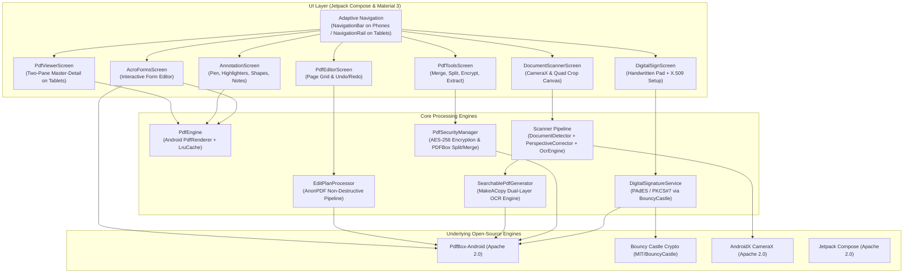

# Ultimate PDF 📄⚡
[](https://github.com/MiguelDLM/ultimate-pdf/releases) [-3DDC84?logo=android&logoColor=white)](https://github.com/MiguelDLM/ultimate-pdf/blob/main/app/build.gradle.kts) [](https://github.com/MiguelDLM/ultimate-pdf/releases/latest) [](https://kotlinlang.org)

> **The Ultimate Open-Source Adobe Acrobat Replacement for Android (Smartphones & Tablets)**  
> Built with modern **Jetpack Compose**, **Material 3**, **PdfBox-Android**, **CameraX**, and **Bouncy Castle**.

**Produced by [Museo Virtual Nacional](https://museovirtualnacional.com)** · package `com.museovirtualnacional.updf` · version 1.0

Ultimate PDF unifies the finest architectural innovations and battle-tested components from the leading open-source Android and desktop PDF ecosystems into a single, cohesive, responsive mobile application for phones and tablets.

---

## 🏛 Architectural Foundations & Reference Projects

Ultimate PDF synthesizes technical breakthroughs from nine premier open-source PDF projects:

| Reference Project | Primary Specialty | Key Technical Strengths Extracted | License | Upstream Source | Ultimate PDF Integration |
|---|---|---|---|---|---|
| **MakeACopy** | Document Scanner & OCR | Edge detection, perspective warping, OCR layout analysis, dual-layer searchable PDF generation | Apache 2.0 | `egdels/makeacopy` | Searchable PDF generator using `RenderingMode.NEITHER` with matrix token positioning |
| **FairScan** | Lightweight CameraX Scanner | Modern Jetpack Compose UI, CameraX capture lifecycle, responsive cropping handles | GPL-3.0 | `pynicolas/FairScan` | Interactive 4-point quadrilateral crop overlay with real-time feedback |
| **AnonPDF** | Non-Destructive Page Ops | Immutable `EditPlan` and `EditOp` history folding, zero-loss page manipulation, undo/redo | MIT | `FanFeast/anonpdf` | Core Page Organizer engine: rotate, reorder, crop, insert, watermark without disk thrashing |
| **PDF Converter (Swati)** | Swiss-Army Utilities | Batch operations: merge, split, encrypt, decrypt, watermark, text/image extraction | GPL-3.0 | `Swati4star/Images-to-PDF` | The PDF Tools toolbox: AES-256 security, multi-file merging, range splitting, asset ripping |
| **Open PDF Studio** | Annotations & Vector Markup | Highlighters, freehand ink, vector shapes (rectangles, arrows, notes), standard XFDF | LGPL-3.0 | `OpenAEC-Foundation` | Interactive annotation canvas with stylus pen support and multi-color palette |
| **PdfBox-Android** | Structural Manipulation & Forms | Native Apache PDFBox port for Android, full AcroForms support, dictionary manipulation | Apache 2.0 | `TomRoush/PdfBox-Android` | Deep PDF object manipulation, AcroForm field serialization, document assembly |
| **MuPDF / Artifex** | High-Speed Rendering | Fast rasterization, memory efficiency, viewport tile rendering | AGPL-3.0 / Comm. | `ArtifexSoftware` | Dual-engine rendering architecture (Native `PdfRenderer` + high-DPI scaling) |
| **PdfiumAndroid** | Native JNI Engine | Memory-mapped PDFium bindings, 16 KB page memory support | Apache 2.0 | `oothp/PdfiumAndroid` | High-res viewport and tile rendering patterns for tablet pinch-to-zoom |
| **Open-PDF-Sign** | Digital Signatures | PKCS#7 / PAdES standard signing with X.509 certs, TSA timestamping, visible stamps | Apache 2.0 | `open-pdf-sign/open-pdf-sign` | Enterprise PAdES signer with Bouncy Castle + custom handwritten signature canvas |

---

## 🧩 System Architecture



---

## 🚀 Key Modules & Capabilities

### 1. Dual-Engine Document Viewer
- Hardware-accelerated rendering using Android's native `PdfRenderer`.
- Memory-safe LRU bitmap caching with dynamic down/up-sampling.
- Smooth pinch-to-zoom (up to 500%) and pan gestures.
- Built-in **Dark Mode / Invert Colors** toggle using a custom `ColorMatrixColorFilter` for comfortable reading in low-light environments.
- **Adaptive layout**:
  - **Smartphone**: Single fluid viewport with a bottom thumbnail strip and floating page counters.
  - **Tablet**: Master-Detail Two-Pane layout featuring a permanent left vertical thumbnail drawer and a high-resolution workspace on the right pane.

### 2. Non-Destructive Page Organizer (EditPlan)
- Based on **AnonPDF's** immutable operations architecture.
- All actions (rotating 90°, deleting, restoring, moving, reordering, inserting from other PDFs, applying watermarks and page numbers) are folded into a normalized `EditPlan`.
- Complete **Undo and Redo** capability.
- The original document is never mutated on disk until you explicitly tap **Export**.

### 3. Smart Document Scanner with Searchable PDF (OCR)
- Automatic quadrilateral corner detection (`DocumentDetector`) analyzing document paper contrast against desk backgrounds.
- Interactive, draggable corner pins with real-time polygon feedback.
- Perspective correction (`PerspectiveCorrector`) that rectifies skewed camera angles using projective transformations.
- Visual document enhancement filters:
  - **Magic Color**: Boosts contrast and text clarity while preserving colored stamps and logos.
  - **Grayscale**: Clean monochromatic document conversion.
  - **High-Contrast B&W**: Threshold binarization for archival and printing.
- **Searchable PDF Generator**: Embeds high-resolution imagery with an overlay of invisible, selectable text (`RenderingMode.NEITHER`) based on OCR coordinates. Text can be searched, copied, and selected inside any standard PDF reader.

### 4. Interactive AcroForms Filler
- Automatic introspection of PDF interactive form fields (`PDTextField`, `PDCheckBox`, `PDRadioButton`, `PDChoice`).
- Real-time Material 3 inputs: Text fields, switches, and radio option lists.
- Writes form values back into the PDF and calls `acroForm.refreshAppearances()` to ensure compatibility with all external viewers.

### 5. Annotations, Ink & Markup
- Inspired by **Open PDF Studio**:
  - **Freehand Pen**: Smooth stylus or finger drawing.
  - **Highlighter**: Semi-transparent yellow/color overlay blending over text.
  - **Geometric Boxes & Shapes**: Rectangles and bounding areas.
  - **Sticky Notes**: Text notes and comments.
- Color palette and stroke width selectors.
- Stylus support with palm rejection considerations.

### 6. Enterprise Digital Signatures (PAdES / PKCS#7)
- Cryptographic digital signatures following the European **PAdES (PDF Advanced Electronic Signatures)** baseline and PKCS#7 standards via **Bouncy Castle**.
- Supports X.509 certificates loaded from PKCS#12 (`.p12` / `.pfx`) keystores.
- Interactive **Handwritten Signature Pad**: Captures clean, high-resolution signatures using finger or stylus.
- Automatically generates a visible signature stamp combining the user's handwritten mark with cryptographic identity metadata (Signer Name, Date/Time, Reason, Location).

### 7. Swiss-Army PDF Tools
- **Merge**: Combine two or more PDF files into a single consolidated file.
- **Split**: Divide documents by page intervals.
- **AES-256 Encryption**: Protect files with standard user and owner passwords and granular permission flags (printing, copying, annotation).
- **Password Removal**: Decrypt and unlock documents.
- **Asset Extraction**: Extract all embedded JPEG/PNG images and rip clean text strings.

---

## 🛠 Project Structure

```
documents/software/
├── app/
│   ├── build.gradle.kts                   # Dependencies & compile SDK 36
│   └── src/
│       ├── main/
│       │   ├── AndroidManifest.xml        # Intents for application/pdf & images
│       │   ├── java/org/ultimatepdf/
│       │   │   ├── UltimatePdfApp.kt      # App entry point & BouncyCastle provider init
│       │   │   ├── core/
│       │   │   │   ├── model/             # DocumentModel, EditPlan, Annotations, Forms, Signatures
│       │   │   │   ├── pdf/               # PdfEngine, EditPlanProcessor, SearchablePdfGen, Security, Signer
│       │   │   │   └── scanner/           # DocumentDetector, PerspectiveCorrector, OcrEngine
│       │   │   └── ui/                    # Adaptive Compose UI
│       │   │       ├── MainActivity.kt    # Responsive Phone/Tablet Shell
│       │   │       ├── viewer/            # Master-Detail PDF Viewer
│       │   │       ├── editor/            # Page Organizer with Undo/Redo
│       │   │       ├── scanner/           # Camera & Interactive Quad Crop
│       │   │       ├── forms/             # AcroForms Editor
│       │   │       ├── annotation/        # Pen, Highlighter & Vector Shapes
│       │   │       ├── sign/              # Handwritten Pad & PAdES Signer
│       │   │       └── tools/             # Utilities Grid
│       │   └── res/                       # Colors, adaptive icons, themes
│       └── test/                          # Unit test suite (EditPlanTest, ScannerMathTest)
├── build.gradle.kts                       # Top-level build config
├── settings.gradle.kts                    # Repositories & project include
├── gradle.properties                     # JVM & caching flags
└── gradlew                                # Gradle wrapper
```

---

## 📦 Building & Testing

### Prerequisites
- JDK 17, 21, or 25
- Android SDK with API 36 Build-Tools

### Running Unit Tests
```bash
./gradlew testDebugUnitTest
```

### Building the Debug APK
```bash
./gradlew assembleDebug
```
The compiled, runnable APK will be output to:
`app/build/outputs/apk/debug/app-debug.apk`

---

## 📄 License & Attribution
Ultimate PDF is released under the **Apache License 2.0** (see [`LICENSE`](LICENSE) and [`NOTICE`](NOTICE)).  
Special thanks to the authors and maintainers of **MakeACopy**, **FairScan**, **AnonPDF**, **Images-to-PDF**, **Open PDF Studio**, **PdfBox-Android**, **MuPDF**, **PdfiumAndroid**, and **Open-PDF-Sign**.
